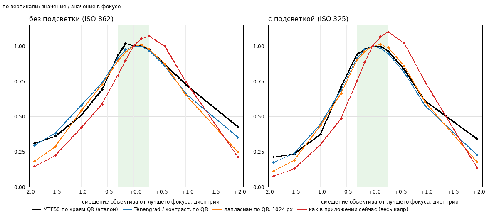

# Как определять резкость снимка: эксперимент на настроечной странице

Дата: 2026-10-23. Вопрос: какую метрику резкости считать на телефоне, чтобы она надёжно
отличала чёткий снимок от размытого. Метод: контролируемый ряд расфокусировки настроечной
страницы с физическим эталоном резкости и сравнением кандидатов. Данные и скрипты:
[perf-results/sharpness/](perf-results/sharpness/).

Принцип (решение владельца, 2026-10-23): вычисление резкости **запускается только по
требованию** (`include_metrics`), а не на каждом снимке и не постоянно по превью.

## Главное

- **Нынешняя метрика приложения** (дисперсия лапласиана по всему кадру, копия 1024 px) качественно
  верна, но грубая: с эталоном согласуется на ρ = 0,93, достигает максимума не в фокусе и
  преувеличивает потерю резкости.
- **Лучше мерить по маркерам.** Метрика по QR-меткам настроечной страницы (Tenengrad,
  нормированный на контраст; или лапласиан по копии 1024 px) согласуется с эталоном на ρ = 0,975, а её кривая
  почти повторяет кривую эталона. Метки всегда стоят рядом с документом, поэтому у
  приложения есть постоянная, чистая и неподвижная мишень.
- **Без маркеров универсальная замена хуже:** метрика по «содержательным плиткам» любого кадра
  дала ρ = 0,84, то есть хуже нынешней. Генерировать резкость по произвольному кадру
  надёжно без опорной мишени не удалось.
- **Допуск фокуса большой:** в пределах ±0,3 диоптрии от лучшего фокуса (≈ ±7 см при 51 см до листа)
  физическая резкость практически не меняется (MTF50 ≥ 93 % от максимума). Заметно хуже ±0,6 D,
  плохо от ±1 D.
- **Свет меняет саму резкость:** при совершенном фокусе MTF50 0,31 цикл/px с подсветкой (ISO 325)
  против 0,20 без неё (ISO 862): камера на высоком ISO сглаживает деталь. Пороги нужно
  привязывать к условиям света, как и подсказки «включите подсветку».

## Мишень и установка

Настроечная страница `calibration_A4.pdf` (печать 100 %): четыре QR-кода 45×45 мм (33 модуля, модуль
1,364 мм), шкала 100 мм, область документа. На фото модуль QR около 17 px, то есть мишень
крупная и резкая. Телефон на штативе, расстояние до листа ≈ 51 см (автофокус дал 1,955 диоптрии), снимок 12,5 Мп
(3060×4080), три QR целиком в кадре (четвёртый срезан краем), лист и камера неподвижны всю серию. Лист лежит
под углом 1,8–5,8° к пиксельной сетке, чего достаточно для измерения по наклонному краю.

## Как снимали

1. Сборка с **временным отладочным патчем** (не входит в код приложения:
   [focus-distance.patch](perf-results/sharpness/focus-distance.patch)): маршрут `POST /debug/focus-distance` ставит объектив
   в заданное положение в диоптриях и ждёт подтверждения камерой.
2. Автофокус по верхнему левому QR, положение d0 = 1,955 D.
3. 13 положений объектива: d0 + {−1,9; −1,5; −1,0; −0,6; −0,3; −0,15; 0; +0,15; +0,3; +0,6; +1,0; +2,0; 0}.
   Последнее значение 0 повторяет опорное для проверки стабильности. По 3 снимка на положение.
4. Два состояния света: подсветка выключена (выдержка 0,03 с, ISO 862) и включена (ISO 325).
   Всего 78 кадров. Положение объектива подтверждалось по результату съёмки (допуск 0,05 D).
5. Проверка стабильности: MTF50 в начале и конце серии 0,200/0,204 (без подсветки) и 0,315/0,314
   (с подсветкой), то есть лист не сдвигался и сцена была стабильна.

## Что считали

**Эталон — MTF50 по наклонному краю** (в духе ISO 12233). Краями служат внешние границы
искательных узоров QR (чёрный на белом, поле вокруг ≥4 модулей). Для каждого из ≈20 краёв с наклоном
1,4–10°: положение края уточняется по центрам градиента вдоль края и линейной подгонке (с отбрасыванием
выбросов); все пиксели полосы разносятся по расстоянию до линии в корзины 0,25 px и усредняются (профиль края, ESF);
производная даёт профиль линии (LSF); окно Хэнна, преобразование Фурье, нормировка на нуль,
MTF50 в цикл/px (линейная интерполяция) и ширина перехода 10–90 % в px. Окно: 30 px снаружи, 10 px внутри
маркера. Результат кадра — медиана по краям. Эталон получен на всех 78 кадрах, но на сильно размытых использовано меньше краёв:
17–19 в фокусе, 13–15 при −1,0 D, 7–11 при ±2 D (часть краёв отбрасывается как непригодные).

**Кандидаты:**

| Метрика | Что это |
| --- | --- |
| `app_global`, `app_center`, `app_tile_max`, `app_tile_median` | как в приложении: кадр до 1024 px, дисперсия лапласиана, по всему кадру, по центру, максимум и медиана по плиткам 4×4 |
| `qr_lapvar_full`, `qr_lapvar_1024` | дисперсия лапласиана по областям QR (полное разрешение и копия 1024 px) |
| `qr_tenengrad_full`, `qr_tenengrad_norm` | средняя энергия градиента Собеля по областям QR; вторая нормирована на квадрат контраста (p95−p5) |
| `qr_lapvar_norm`, `qr_lapvar_minus_noise` | лапласиан, нормированный на контраст; лапласиан за вычетом шума, измеренного на чистом поле бумаги |
| `edge_width_marziliano` | ширина границ по методу Марзилиано (расстояние между экстремумами яркости вокруг сильных краёв) |
| `sfr_width10_90`, `sfr_mtf50` | ширина перехода и MTF50 по наклонным краям (сам эталон) |
| `gen_tile_median`, `gen_tile_p75` | без маркеров: энергия градиента, нормированная на контраст, по плиткам 8×8 копии 1024 px, где контраст > 30 |

**Показатели оценки:** ρ Спирмена с эталоном (78 кадров, оба света), ρ с известной расфокусировкой −|смещение|,
отношение значения в фокусе с подсветкой к значению без неё («светоустойчивость»; у самого эталона 1,56),
отношение значения в фокусе к значению при |смещении| 0,3 и 0,6 D (чувствительность), разброс по трём повторным кадрам.
Скрипты считают всё в полном разрешении 12,5 Мп под ограничением памяти (`ulimit -v`).

## Результаты

Относительные кривые (значение / значение в фокусе) по смещению объектива, диоптрии:

| Метрика, свет | −1,9 | −1,5 | −1,0 | −0,6 | −0,3 | −0,15 | 0 | +0,15 | +0,3 | +0,6 | +1,0 | +2,0 |
| --- | --- | --- | --- | --- | --- | --- | --- | --- | --- | --- | --- | --- |
| MTF50 (эталон), без подсветки | 0,31 | 0,36 | 0,51 | 0,69 | 0,93 | 1,02 | 1,00 | 1,00 | 0,98 | 0,87 | 0,73 | 0,43 |
| MTF50 (эталон), с подсветкой | 0,21 | 0,23 | 0,37 | 0,71 | 0,94 | 0,98 | 1,00 | 1,00 | 0,96 | 0,84 | 0,61 | 0,34 |
| Tenengrad / контраст по QR, без подсветки | 0,30 | 0,38 | 0,58 | 0,74 | 0,91 | 0,98 | 1,00 | 1,00 | 0,97 | 0,86 | 0,66 | 0,35 |
| Tenengrad / контраст по QR, с подсветкой | 0,17 | 0,24 | 0,44 | 0,69 | 0,91 | 0,98 | 1,00 | 0,99 | 0,95 | 0,82 | 0,58 | 0,23 |
| Лапласиан по QR (1024 px), без подсветки | 0,18 | 0,29 | 0,54 | 0,73 | 0,90 | 0,96 | 1,00 | 1,01 | 0,98 | 0,87 | 0,65 | 0,25 |
| Лапласиан по QR (1024 px), с подсветкой | 0,11 | 0,19 | 0,43 | 0,66 | 0,90 | 0,96 | 1,00 | 1,01 | 0,99 | 0,86 | 0,61 | 0,18 |
| Как в приложении (весь кадр), без подсветки | 0,15 | 0,22 | 0,42 | 0,59 | 0,79 | 0,90 | 1,00 | 1,05 | 1,07 | 1,00 | 0,75 | 0,21 |
| Как в приложении (весь кадр), с подсветкой | 0,08 | 0,13 | 0,30 | 0,49 | 0,75 | 0,88 | 1,00 | 1,07 | 1,10 | 1,02 | 0,75 | 0,13 |



Абсолютные значения эталона в фокусе: MTF50 0,20 (без подсветки) и 0,31 цикл/px (с подсветкой), ширина перехода
10–90 % 2,9 и 1,5 px; при смещении ±1 D ширина 4,3–6,0 px и 3,3–5,9 px, при −1,9 D около 11 px.

Оценка кандидатов (все 78 кадров):

| Метрика | ρ с эталоном | ρ с расфокусировкой | Светоустойчивость (эталон 1,56) | Чувств. при 0,3 D | Чувств. при 0,6 D | Разброс повторов, % |
| --- | --- | --- | --- | --- | --- | --- |
| `sfr_mtf50` (эталон) | 1,000 | 0,823 | 1,56 | 1,05 | 1,29 | 1,75 |
| `qr_tenengrad_full` | 0,976 | 0,843 | 1,72 | 1,08 | 1,33 | 0,04 |
| **`qr_tenengrad_norm`** | **0,975** | 0,867 | **1,51** | 1,07 | 1,30 | 0,10 |
| `qr_lapvar_minus_noise` | 0,975 | 0,859 | 2,16 | 1,12 | 1,56 | 0,18 |
| `qr_lapvar_full` | 0,974 | 0,861 | 2,13 | 1,12 | 1,55 | 0,18 |
| **`qr_lapvar_1024`** | **0,974** | 0,847 | **1,58** | 1,06 | 1,29 | 0,09 |
| `qr_lapvar_norm` | 0,973 | 0,863 | 1,86 | 1,11 | 1,51 | 0,15 |
| `sfr_width10_90` | 0,961 | 0,864 | 0,52 | 1,10 | 1,53 | 1,00 |
| `edge_width_marziliano` | 0,954 | 0,858 | 0,43 | 1,12 | 1,50 | 0,00 |
| `app_tile_median` | 0,943 | 0,801 | 1,78 | 1,20 | 1,76 | 0,20 |
| `app_global` (сейчас в приложении) | 0,927 | 0,753 | 1,70 | 1,08 | 1,30 | 0,07 |
| `app_tile_max` | 0,893 | 0,661 | 1,61 | 0,94 | 0,98 | 0,06 |
| `gen_tile_median` (без маркеров) | 0,844 | не считали | не считали | не считали | не считали | не считали |
| `app_center` | 0,815 | 0,623 | 1,97 | 1,09 | 1,22 | 0,13 |

## Выводы

1. **По маркерам лучше, чем по кадру.** Метрики по QR (ρ ≈ 0,975) заметно лучше нынешней (0,927) и
   повторяют кривую эталона. У `qr_tenengrad_norm` и `qr_lapvar_1024` ещё и светоотношение 1,51 и 1,58 при 1,56
   у эталона: они видят реальное ухудшение резкости в темноте, а не расходятся с ним, как `qr_lapvar_full` (2,13).
   Копия 1024 px подавляет шум и стоит дешевле, поэтому лапласиан по QR на копии 1024 px это самый простой хороший вариант.
2. **Нынешняя метрика теряет в трёх местах:** максимум не в фокусе, а при +0,15…+0,3 D (до 10 % выше «фокуса»);
   теряет резкость быстрее реальной (при −0,6 D 0,49–0,59 против 0,69–0,71 у эталона), из-за квадратичной шкалы;
   сильнее зависит от содержимого кадра (все метрики по всему кадру ниже).
3. **Универсальной метрики без маркеров не нашлось:** плитки по содержимому (ρ = 0,84) плохи, потому что на размытом
   кадре текстура стола и бумаги сохраняет энергию градиента, а нормировка на контраст усиливает шум в слабоконтрастных
   плитках.
4. **QR-декодирование не годится как индикатор размытия:** коды читаются даже при смещении 2 D (у кода коррекция
   ошибок уровня H), на копии 1024 px падает раньше, но нерегулярно (1,3–3 кода из 3 без закономерности).
5. **Шум на этой мишени не мешает:** на чистой бумаге дисперсия лапласиана 3,5 (без подсветки) и 1,9 (с подсветкой), в
   областях QR 190–400, то есть ≤ 2 %. Наблюдение «шум завышает резкость» из прошлых замеров относится
   к кадрам с малым контентом (почти пустой лист), где сигнала мало.
6. **Свет и ISO физически снижают резкость:** при ISO 862 MTF50 в фокусе на 35 % ниже, чем при ISO 325. Это не ошибка метрики:
   качество снимка действительно хуже, и подсказка «включите подсветку» осмысленна.
7. **Допуск фокуса:** ±0,3 D (≈ ±7 см) практически не меняет резкость (эталон ≥ 0,93), поэтому лист толщиной в миллиметры
   относительно метки не вносит заметной ошибки.
8. **Повторяемость** метрик по трём кадрам ≤ 0,2 % (эталон 1,75 %), стабильность сцены между началом и концом серии 2 %.

## Что делать в приложении

Все вычисления только по требованию (`include_metrics`), кэшируются с хэндлом снимка.

1. **Основной вариант:** найти QR-метки (они всегда рядом с документом, детектор у нас уже есть в калибровке), посчитать
   лапласиан (или Tenengrad, нормированный на контраст) в областях меток на копии 1024 px, взять медиану по меткам.
   Показать как отношение к **эталону резкости, снятому при калибровке** (в моменте лучшей наводки на метки).
2. **Предварительные зоны по отношению к эталону** (на этих данных, до проверки распознаванием): ≥ 0,9 хорошо
   (≈ ±0,3 D); 0,6–0,9 мягковато (≈ ±0,6 D); ниже ≈ 0,6 плохо (≈ ±1 D и дальше; там значения 0,44–0,66,
   граница размыта). Это пока про физику кадра, не про то, что прочитает
   paper-ledger.
3. **Запасной вариант без маркеров:** оставить нынешний лапласиан по кадру, но помечать результат как менее надёжный
   (ρ = 0,93) и не использовать его для порогов.
4. **Свет:** сообщать вместе с резкостью ISO и выдержку из EXIF, чтобы подсказка различала «не навели» и «слишком темно».

## Не проверено и ограничения

- **Критерий «прочитает ли paper-ledger» не измерялся.** Пороги по распознаванию не определены. Следующий шаг: ту же
  серию расфокусировки снять на настоящей странице с цифрами (УПД), прогнать конвейер paper-ledger и сопоставить долю
  верных значений с метрикой (по правилу вашего журнала экспериментов).
- Только расфокусировка, **смаз от дрожи не исследовался** (для него нужен акселерометр и отдельная серия).
- Одно устройство (Redmi 12), одно расстояние (≈ 51 см), одна страница, один JPEG-профиль (качество 95), два состояния света.
- Эталон надёжен для умеренной размытости; при смещении ±2 D использовано 7–11 краёв из 20, а окно профиля (10 px
  внутрь маркера) ограничивает измерение очень размытых краёв.
- Метрики посчитаны на Python (OpenCV) по сохранённым снимкам; **версия для телефона не написана** и ещё не сверена с
  этими числами. Алгоритм Марзилиано в моей реализации грубый (целочисленные ширины, чувствителен к шуму) и не рекомендуется.
- Четвёртый QR срезан краем кадра, использованы три.

## Как повторить

Нужны: сборка с временным патчем (`git apply docs/perf-results/sharpness/focus-distance.patch`), напечатанная
настроечная страница в масштабе 100 % под камерой, телефон по USB, Python с OpenCV, NumPy и SciPy (подойдёт окружение paper-ledger).

```sh
# снять серию (в каталог shots/, 78 кадров, два света)
python3 docs/perf-results/sharpness/sharp_capture.py <каталог>/shots
# найти QR в кадрах около фокуса и посчитать метрики
python3 docs/perf-results/sharpness/find_quads.py <каталог>
python3 docs/perf-results/sharpness/sharp_analyze.py <каталог>
python3 docs/perf-results/sharpness/sharp_generic.py <каталог>
python3 docs/perf-results/sharpness/sharp_summary.py <каталог>
python3 docs/perf-results/sharpness/sharp_plot.py <каталог>
```

Снимки не хранятся в репозитории (148 МБ); в `sharpness-results.json` лежат только числа по каждому кадру.
После опыта вернуть код: `git checkout -- androidApp/`.
